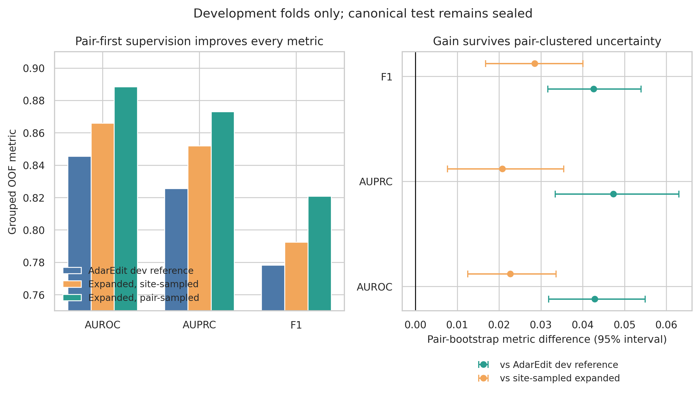
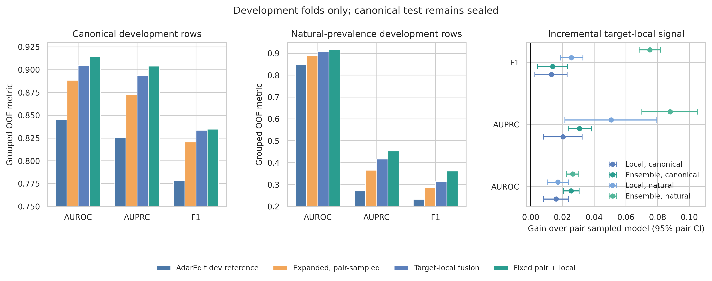
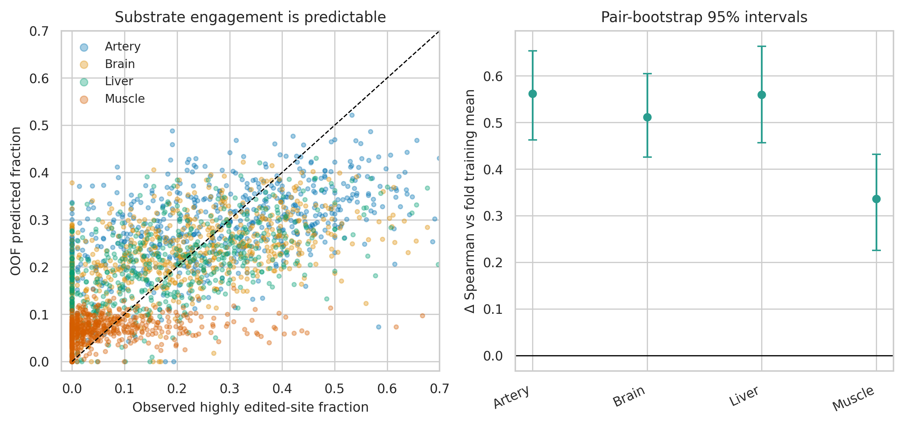

# 16 — Richer supervision and substrate-context frontier

Date: 2026-08-21–22. All results in this report are from the sealed
train+validation development portion. No candidate model accessed the canonical
test partition.

## Benchmark authority

The published supplied-checkpoint AdarEdit canonical-test result remains the
authoritative baseline and the final target. Grouped development out-of-fold
(OOF) predictions are used only to compare incremental signal under identical
pair-disjoint folds. Their absolute values are not a replacement, correction,
or estimate of the published benchmark.

## Expanded high/low supervision

The canonical binary benchmark is balanced before splitting. On training pairs,
however, the raw tissue table contains many additional unambiguous sites with
EditingIndex below 1% or at least 15%. The expanded-supervision model keeps the
compact Baseline GAT architecture fixed and changes only supervision:

- training data: every eligible high/low site on non-held-out development pairs;
- stochastic sampling: equal high/low states;
- per-epoch update budget: identical to the canonical training-row count;
- checkpoint and threshold selection: the same disjoint inner fold;
- evaluation: the unchanged canonical development rows in each outer fold.

Across 5,967 canonical Muscle rows from 585 pairs, the candidate reached AUROC
0.8659, AUPRC 0.8520 and F1 0.7924. The identical-fold AdarEdit development
reference reached 0.8456, 0.8256 and 0.7783. Pair-clustered bootstrap median
differences (95% interval) were:

| Metric | Candidate | Development reference | Paired difference |
|---|---:|---:|---:|
| AUROC | 0.8659 | 0.8456 | +0.0201 (+0.0098, +0.0300) |
| AUPRC | 0.8520 | 0.8256 | +0.0266 (+0.0123, +0.0413) |
| F1 | 0.7924 | 0.7783 | +0.0142 (+0.0027, +0.0259) |
| Precision | 0.7585 | 0.7238 | +0.0341 (+0.0239, +0.0453) |
| Recall | 0.8296 | 0.8415 | -0.0118 (-0.0296, +0.0057) |
| Specificity | 0.7445 | 0.6894 | +0.0545 (+0.0400, +0.0700) |
| MCC | 0.5756 | 0.5364 | +0.0391 (+0.0167, +0.0613) |
| Brier | 0.1515 | 0.1695 | -0.0178 (-0.0252, -0.0108) |

The gain is not perfectly homogeneous: outer-fold F1 differences were +0.0289,
+0.0245, +0.0086, -0.0153 and +0.0234. Pair-balanced sampling and a second
tissue therefore remain mandatory controls.

### Pair-balanced expanded supervision

The prespecified sampling control changes no input, architecture, outer fold,
inner-fold checkpoint/threshold rule, or epoch update count. Within each
absent/high state it samples an Alu pair uniformly and then a site uniformly
within that pair. This prevents a few site-rich substrates from dominating the
optimization when the independent biological unit is the pair.

This is the strongest development result so far. Pair-balanced expanded
supervision reached AUROC 0.8885, AUPRC 0.8730 and F1 0.8208. Relative to the
identical-fold AdarEdit development reference, pair-clustered median differences
(95% interval; 2,000 replicates) were:

| Metric | Candidate | Development reference | Paired difference |
|---|---:|---:|---:|
| AUROC | 0.8885 | 0.8456 | +0.0429 (+0.0319, +0.0550) |
| AUPRC | 0.8730 | 0.8256 | +0.0473 (+0.0334, +0.0630) |
| F1 | 0.8208 | 0.7783 | +0.0426 (+0.0316, +0.0539) |
| Precision | 0.7711 | 0.7238 | +0.0474 (+0.0353, +0.0597) |
| Recall | 0.8773 | 0.8415 | +0.0359 (+0.0183, +0.0548) |
| Specificity | 0.7481 | 0.6894 | +0.0586 (+0.0407, +0.0772) |
| MCC | 0.6298 | 0.5364 | +0.0932 (+0.0700, +0.1173) |
| Brier | 0.1372 | 0.1695 | -0.0324 (-0.0411, -0.0245) |

It added 105 true positives while removing 178 false positives. More explicitly,
it corrected 386/942 baseline false positives (FP rescue 41.0%) while creating
208 new false positives, and suppressed 140/2,469 baseline true positives (TP
damage 5.7%) while recovering 245 baseline false negatives. AUROC and F1
improved in all five outer folds; foldwise F1 differences were +0.0326,
+0.0404, +0.0388, +0.0195 and +0.0801.

The gain is not merely the already observed benefit of more rows. Against the
site-balanced expanded model itself, pair balancing adds median +0.0227 AUROC
(95% interval +0.0125, +0.0336), +0.0208 AUPRC (+0.0076, +0.0355), and
+0.0285 F1 (+0.0168, +0.0401), while improving Brier by 0.0145. This supports
pair-first optimization as an important modeling correction to the effective
sample size. Subsequent Liver, Artery and Brain runs replicated the direction;
the target-local section below reports the selected architectural extension.

A descriptive pair-size audit supports that interpretation. Relative to the
site-balanced expanded model, the pair-balanced model's mean per-pair log-loss
gain was 0.070 and 0.064 in the two smallest quintiles of raw eligible-site
count, approximately zero in the middle quintile, and -0.011 and -0.037 in the
two largest quintiles. The pair-level Spearman association between raw-site
count and pair-balancing gain was -0.131 (p=0.0015). Thus pair-first sampling
redistributes accuracy toward substrates that site-wise sampling underweights;
it is not merely a global probability shift. This analysis is descriptive and
does not alter model selection.

### Independent Liver replication

The identical pair-balanced protocol was then run in Liver, using Liver's
independently generated five-fold development reference. On 15,509 canonical
rows from 508 pairs, the candidate reached AUROC 0.9089, AUPRC 0.8907 and F1
0.8365, versus 0.8909, 0.8737 and 0.8200 for the identical-fold development
reference. Pair-clustered median differences (95% interval; 1,000 replicates)
were +0.0179 AUROC (+0.0118, +0.0237), +0.0172 AUPRC (+0.0070, +0.0271), and
+0.0164 F1 (+0.0096, +0.0230). Precision, recall, specificity, MCC and Brier
also improved with intervals excluding zero in the favorable direction.

All five outer folds improved AUROC, AUPRC and F1. The model added 145 true
positives and removed 107 false positives overall: it corrected 596 of 1,772
development-reference false positives while introducing 489 new false
positives, and recovered 463 false negatives while suppressing 318 true
positives. This independent-context replication meets the prespecified advance
rule. Pair-balanced expanded high/low supervision is therefore the leading
successor component, although its absolute OOF scores remain only internal
development measurements. The published Liver test result (AUROC 0.9092, F1
0.8541) remains the authoritative benchmark and has not been re-evaluated.

### Site-balanced natural-prevalence secondary evaluation

The same fold-held-out checkpoints were applied to all 54,289 eligible high/low
Muscle development rows (5.40% edited prevalence) without downsampling. AUROC
increased from 0.8478 to 0.8680, AUPRC from 0.2711 to 0.3211, and F1 from 0.2328
to 0.2658. Pair-bootstrap median differences were +0.0200 AUROC
(+0.0120, +0.0283), +0.0492 AUPRC (+0.0225, +0.0755), and +0.0326 F1
(+0.0254, +0.0402). At the transported canonical thresholds the candidate had
2,858 fewer false positives, 35 fewer true positives, specificity +0.0552 and
recall -0.0121 (median paired differences).

This is the strongest current evidence that the gain reflects improved learning
from available biological observations rather than exploitation of the balanced
canonical sample.

The pair-balanced model strengthens that conclusion. On the same 54,289 rows,
it reached AUROC 0.8900, AUPRC 0.3659 and F1 0.2868, compared with
0.8478/0.2711/0.2328 for the development reference. Pair-clustered median
differences were +0.0419 AUROC (95% interval +0.0317, +0.0531), +0.0944 AUPRC
(+0.0663, +0.1206), and +0.0539 F1 (+0.0450, +0.0623). At the transported
inner-selected thresholds it removed 3,363 false positives while adding 105
true positives; specificity increased by a median 0.0656 and recall by 0.0352,
with both intervals above zero.

The independent Liver natural-prevalence result is concordant. Across all
38,096 eligible high/low development rows (19.7% edited), the pair-balanced
model reached AUROC 0.9094, AUPRC 0.7128 and F1 0.6418, versus 0.8915, 0.6732
and 0.6246 for the same-fold development reference. Pair-clustered median
differences (95% interval) were +0.0178 AUROC (+0.0126, +0.0231), +0.0397
AUPRC (+0.0188, +0.0609), and +0.0174 F1 (+0.0080, +0.0269); Brier improved
by 0.0082 (+0.0027 to +0.0139 reduction). The transported fold-specific
thresholds removed 248 false positives and added 145 true positives. Thus the
replication is not restricted to the balanced canonical development sample.

The completed natural-prevalence audit is directionally consistent across all
five endpoints:

| Context | Reference F1 | Pair-balanced F1 | ΔAUROC | ΔAUPRC | ΔF1 |
|---|---:|---:|---:|---:|---:|
| Artery | 0.7125 | 0.7336 | +0.0135 | +0.0302 | +0.0211 |
| Brain | 0.6913 | 0.7014 | +0.0114 | +0.0347 | +0.0101 |
| Liver | 0.6246 | 0.6418 | +0.0178 | +0.0395 | +0.0173 |
| Muscle Skeletal | 0.2328 | 0.2868 | +0.0422 | +0.0948 | +0.0540 |
| Combined | 0.6327 | 0.6533 | +0.0146 | +0.0430 | +0.0206 |

The pair-bootstrap 95% intervals for AUROC, AUPRC and F1 exclude zero in the
favorable direction in every row of this table.

### Artery and Brain confirmation

The unchanged pair-balanced protocol also improved both remaining individual
tissues. Artery reached AUROC 0.9204, AUPRC 0.9096 and F1 0.8458, versus
0.9081/0.8958/0.8388 for its same-fold internal reference. Pair-bootstrap
median differences were +0.0122 AUROC (95% interval +0.0080, +0.0166),
+0.0137 AUPRC (+0.0079, +0.0197), and +0.0069 F1 (+0.0010, +0.0127). Brain
reached 0.9284/0.9175/0.8579 versus 0.9166/0.9012/0.8466, with differences
+0.0117 AUROC (+0.0082, +0.0154), +0.0164 AUPRC (+0.0102, +0.0220), and
+0.0111 F1 (+0.0061, +0.0164).

Thus expanded pair-first supervision improves ranking in all four individual
tissues, and every tissue's F1 interval excludes zero in the favorable
direction. This strengthens its role as a general training correction rather
than a Muscle-specific discovery.

The separately modeled pooled `Combined` endpoint confirmed the same result:
AUROC/AUPRC/F1 reached 0.9361/0.9281/0.8667 versus
0.9214/0.9111/0.8524 for its identical-fold development reference. Median
pair-bootstrap changes were +0.0145 AUROC (95% interval +0.0109, +0.0184),
+0.0169 AUPRC (+0.0115, +0.0224), and +0.0141 F1 (+0.0094, +0.0198).
`Combined` remains a pooled endpoint and was not used as a tissue in the
cross-tissue model.

### Recall-controlled interpretation

The leakage-safe inner-fold thresholds intended to match baseline recall did not
transport exact recall to outer folds (candidate 0.8102 versus reference 0.8415),
so those outputs cannot support a literal matched-recall claim.

A separate **descriptive** OOF operating-curve audit selected the candidate
threshold on the evaluated OOF labels. At exactly the reference recall of
0.8415, specificity was 0.7135 versus 0.6894 and F1 was 0.7873 versus 0.7783,
avoiding 73 of 942 false positives with identical TP/FN counts. A pair-bootstrap
curve comparison gave median +0.0238 specificity (95% interval 0.0000,
+0.0496), +0.0090 F1 (+0.0001, +0.0191), and 72 fewer false positives
(-149, 0, expressed as candidate minus reference). Because this threshold uses
evaluated labels, it describes ranking potential only; it is not a deployable
threshold or a model-selection result.

## Simultaneous continuous/ordinal/binary learning

The simultaneous multi-task formulation used absent/intermediate/high ordinal
labels plus continuous EditingIndex. It improved ranking (median +0.0119 AUROC
and +0.0166 AUPRC, both with positive 95% intervals) and calibration, but its
median F1 difference was only +0.0066 with an interval crossing zero and strong
fold heterogeneity. Direct comparison did not establish superiority over the
simpler expanded high/low objective. It is retained as a possible ensemble or
revised auxiliary task, not advanced as the standalone successor.

The later pair-sampling result exposed a specific weakness in this first
formulation: intermediate and absent rows are extremely unevenly distributed
among substrates. A single prespecified revision sampled uniformly by pair
within each of the absent/intermediate/high states while preserving the same
epoch update budget.

That revision reached AUROC 0.8967, AUPRC 0.8818 and F1 0.8216. Relative to
the pair-balanced binary model, pair-bootstrap median differences (95%
intervals; 2,000 replicates) were +0.0081 AUROC (+0.0010, +0.0151), +0.0087
AUPRC (-0.0010, +0.0179), +0.0008 F1 (-0.0071, +0.0086), and -0.0069 Brier
(-0.0122, -0.0011). AUROC improved in three folds, whereas F1 improved in only
two. The extra supervision therefore adds a small ranking/calibration signal
but does not improve the primary thresholded result beyond pair-balanced
binary training.

**Decision:** terminate multi-task learning as the standalone successor and do
not tune additional loss weights. Preserve its cross-fitted probabilities as
a complementary candidate for one nested stacking experiment after the base
models are frozen.

That prespecified fixed-stack audit was subsequently completed without an
ensemble-weight search. A 50:50 logit average of pair-balanced binary and
pair-balanced multi-task models reached AUROC 0.9012, AUPRC 0.8877 and F1
0.8280. Relative to pair-balanced binary alone, median differences were
+0.0126 AUROC (95% pair interval +0.0089, +0.0165), +0.0146 AUPRC (+0.0095,
+0.0196), +0.0073 F1 (+0.0007, +0.0139), and -0.0099 Brier (-0.0127,
-0.0070). The auxiliary targets therefore contribute complementary signal
even though their standalone thresholded result does not improve materially.

A fixed equal-logit average of pair-balanced binary, focal pooling and
pair-balanced multi-task models reached AUROC 0.9120, AUPRC 0.9023 and F1
0.8336. Against the simpler pair-balanced plus focal ensemble, it added +0.0028
AUROC (+0.0008, +0.0047), +0.0036 AUPRC (+0.0005, +0.0067), and improved Brier
by 0.0027 (+0.0010, +0.0044 reduction). Its +0.0032 F1 interval crossed zero;
recall rose by +0.0123 while specificity fell by -0.0088. This three-way model
is retained as a small ranking/calibration extension, not yet promoted over the
simpler two-way ensemble for the primary thresholded objective.

Natural-prevalence transport resolves that choice. The three-way model reached
AUROC 0.9137, AUPRC 0.4582 and F1 0.3024, versus 0.9114, 0.4549 and 0.3072 for
the two-way focal ensemble. Three-way minus two-way pair-bootstrap differences
were +0.0023 AUROC (95% interval +0.0008, +0.0037), +0.0030 AUPRC (-0.0042,
+0.0102), and -0.0048 F1 (-0.0093, -0.0004); precision and specificity fell,
and Brier worsened by 0.0022. The extra multitask component is therefore
terminated from the primary successor. It remains a documented secondary
ranking result, while the simpler pair-balanced plus focal ensemble advances.

## Prespecified target-aware pooling probe

The compact AdarEdit GAT explicitly marks the focal adenosine and encodes every
node's position relative to it, but the classifier sees only a global mean of
the final node embeddings. On a long duplex, this can dilute the focal node's
learned state even when message passing itself is informative. The canonical
Muscle graphs have median length 606 nt, making the focal node's direct weight
in an unweighted mean only 0.165%. Before testing a larger graph transformer, a
low-cost architectural probe will concatenate the final focal-node embedding
with the unchanged global-mean embedding. It uses no new annotation, preserves
the pair-balanced expanded-supervision protocol and was registered in the
opportunity tree before its outcome was observed.

The branch advances only for a stable gain beyond the pair-balanced model and
must then survive two controls. A duplicate-global-mean model retains exactly
the same classifier width without adding information. A first-nucleotide model
adds an equally sized nonfocal node representation; because that node still
contains a target-relative coordinate, it is an alternative-node control, not
a pure capacity control. The separate target/partner-aligned local CNN remains
a richer follow-up rather than an automatic replacement.

If focal pooling completes with complementary ranking gains, exactly one
ensemble is prespecified: a fixed 50:50 average of the pair-balanced and focal
model logits. Its threshold is selected on each outer model's disjoint inner
fold. Ensemble weights will not be searched; failure to beat both components
ends this stacking branch.

### Focal-pooling development result

Focal pooling reached AUROC 0.9014, AUPRC 0.8902 and F1 0.8251. Relative to
the pair-balanced expanded-supervision model, pair-bootstrap median differences
(95% interval; 2,000 replicates) were +0.0126 AUROC (+0.0052, +0.0203),
+0.0169 AUPRC (+0.0059, +0.0281), and +0.0043 F1 (-0.0059, +0.0145).
Precision increased by +0.0207 (+0.0087, +0.0326), specificity by +0.0328
(+0.0171, +0.0487), and recall decreased by -0.0160 (-0.0305, -0.0013).
AUROC and AUPRC improved in four of five outer folds; F1 improved in three.
Thus focal pooling supplies robust complementary ranking information but is
not a standalone F1 improvement.

On all 54,289 high/low Muscle development rows at natural prevalence, focal
pooling reached AUROC 0.9042, AUPRC 0.4373 and F1 0.3050, compared with
0.8900, 0.3659 and 0.2868 for pair-balanced training. Pair-bootstrap median
differences were +0.0142 AUROC (95% interval +0.0072, +0.0210), +0.0713 AUPRC
(+0.0448, +0.0967), +0.0182 F1 (+0.0119, +0.0248), and -0.0616 Brier
(-0.0671, -0.0562). This materially stronger AUPRC is consistent with better
prioritization in the low-prevalence setting.

The fixed equal-logit ensemble reached AUROC 0.9092, AUPRC 0.8986 and F1
0.8304. Against pair-balanced training, median differences were +0.0205 AUROC
(+0.0159, +0.0254), +0.0255 AUPRC (+0.0182, +0.0330), +0.0095 F1 (+0.0028,
+0.0166), and -0.0149 Brier (-0.0195, -0.0102). Ranking improved in all five
folds and F1 in four, with the fifth essentially unchanged (-0.0003). The
ensemble is provisionally advanced as the leading architectural add-on.

The first-node control was stopped after three complete outer folds. It was
competitive in fold 0 but underperformed focal pooling in folds 1 and 2, with
no stable gain beyond pair-balanced training. On the 3,579 completed-fold rows,
focal minus first-node median differences were +0.0176 AUROC (95% pair
interval +0.0082, +0.0278), +0.0183 AUPRC (+0.0058, +0.0321), +0.0124 F1
(-0.0012, +0.0258), and -0.0109 Brier (-0.0197, -0.0025). Thus an arbitrary
node embedding does not explain the focal ranking gain.

The stricter duplicate-global-mean control used the same concatenated width,
classifier dimensions, seeded initialization and training protocol as focal
pooling, but duplicated the existing global mean instead of adding focal-site
information. It reached AUROC 0.8802, AUPRC 0.8645 and F1 0.8137—below the
pair-balanced model on all three measures. Focal minus duplicate median
differences were +0.0210 AUROC (95% pair interval +0.0114, +0.0303), +0.0255
AUPRC (+0.0126, +0.0390), +0.0112 F1 (-0.0001, +0.0225), +0.0288 precision
(+0.0171, +0.0411), and +0.0429 specificity (+0.0275, +0.0587). The F1
interval is borderline, but the ranking and false-positive discrimination
effects are not attributable to classifier width alone.

As an additional ensemble control, the fixed pair-balanced plus duplicate-mean
ensemble reached AUROC 0.8936, AUPRC 0.8799 and F1 0.8253. The corresponding
pair-balanced plus focal ensemble was higher by +0.0155 AUROC (95% interval
+0.0099, +0.0208) and +0.0187 AUPRC (+0.0107, +0.0269); its +0.0050 F1
interval crossed zero. The focal component therefore clears both prespecified
representation controls for ranking and calibration. Its standalone F1 gain
remains too small to advance alone, while the fixed ensemble retains its robust
+0.0095 F1 gain over pair-balanced training.

The same fixed ensemble also transported to all 54,289 natural-prevalence
Muscle development rows without retuning. It reached AUROC 0.9114, AUPRC
0.4549 and F1 0.3072. Relative to pair-balanced training, pair-bootstrap
median differences were +0.0214 AUROC (95% interval +0.0172, +0.0256), +0.0891
AUPRC (+0.0730, +0.1052), and +0.0204 F1 (+0.0160, +0.0251), while removing
1,249 false positives and losing only 10 true positives. Relative to focal
pooling alone, the ensemble added +0.0072 AUROC (+0.0044, +0.0101) and +0.0179
AUPRC (+0.0062, +0.0297), whereas F1 was indistinguishable and Brier was worse.
This supports the ensemble for complementary ranking and canonical thresholded
performance, not a claim that it dominates focal pooling on every calibration
criterion.

### Independent Liver focal-pooling replication

The frozen focal-pooling protocol replicated in Liver. On 15,509 canonical
development rows, focal pooling reached AUROC 0.9163, AUPRC 0.9064 and F1
0.8395, versus 0.9089, 0.8907 and 0.8365 for pair-balanced training on the
same folds. Focal-minus-pair pair-bootstrap intervals excluded zero for AUROC
(median +0.0074; 95% interval +0.0026, +0.0126) and AUPRC (+0.0154;
+0.0076, +0.0243); the F1 difference was +0.0028 with an interval spanning
zero. Four of five folds improved AUROC and AUPRC, while three improved F1.

The prespecified equal-logit pair-plus-focal ensemble reached AUROC 0.9228,
AUPRC 0.9120 and F1 0.8490. Relative to pair-balanced training, it added
+0.0139 AUROC (95% interval +0.0112, +0.0169), +0.0210 AUPRC (+0.0163,
+0.0266) and +0.0130 F1 (+0.0056, +0.0208), with favorable Brier,
precision, recall and specificity differences. All five folds improved AUROC,
AUPRC and F1. On the 38,096-row natural-prevalence secondary set, the same
ensemble reached 0.9229/0.7600/0.6640 versus 0.9094/0.7128/0.6418 for
pair-balanced training and 0.8915/0.6732/0.6246 for the development reference
(AUROC/AUPRC/F1). Thus the controlled focal signal and its complementarity
replicate across an independent tissue; target-local fusion remains the
higher-priority candidate under the frozen selection ladder.

## Target/partner-aligned local representation

The stronger local model augments the compact whole-duplex graph encoder with
a deterministic dilated CNN over a prespecified 65-position window centered
on the target adenosine and its dot-bracket-aligned helix partner. It uses the
same pair-balanced expanded supervision, folds, epoch budget, checkpoint rule
and threshold protocol as the comparator. It adds no external annotation and
was specified before the full result was available.

Across all five Muscle folds, the model reached AUROC 0.9045, AUPRC 0.8936 and
F1 0.8337, versus 0.8885, 0.8730 and 0.8208 for pair-balanced training.
Local-minus-pair median differences (95% pair-bootstrap interval; 2,000
replicates) were +0.0161 AUROC (+0.0080, +0.0238), +0.0204 AUPRC (+0.0082,
+0.0325), +0.0131 F1 (+0.0027, +0.0230), and a 0.0085 Brier reduction. Every
fold improved AUROC, AUPRC and F1. This clears the first preregistered advance
condition and supports explicit target-centered geometry beyond pair-first
supervision alone.

The fixed equal-logit pair-plus-local ensemble reached AUROC 0.9142, AUPRC
0.9040 and F1 0.8347. Relative to pair-balanced training it added +0.0256
AUROC (95% interval +0.0207, +0.0305), +0.0308 AUPRC (+0.0236, +0.0384) and
+0.0139 F1 (+0.0045, +0.0234). It also improved AUROC and AUPRC beyond the
local component itself and improved AUROC by +0.0050 (+0.0010, +0.0091)
beyond the earlier pair-plus-focal ensemble; its incremental F1 intervals
against those stronger models cross zero. The result therefore establishes
complementary ranking/calibration value.

Natural-prevalence transport was strongly favorable. On all 54,289 high/low
Muscle development observations, local fusion reached AUROC 0.9072, AUPRC
0.4166 and F1 0.3125, compared with 0.8900/0.3659/0.2868 for pair-balanced
training. Local-minus-pair median differences (95% pair-bootstrap interval)
were +0.0172 AUROC (+0.0104, +0.0239), +0.0508 AUPRC (+0.0216, +0.0796),
and +0.0257 F1 (+0.0188, +0.0330). It added eight true positives while
removing 1,434 false positives.
The pair-plus-local ensemble reached 0.9165/0.4540/0.3621. Relative to
pair-balanced training, median differences were +0.0265 AUROC (+0.0226,
+0.0304), +0.0880 AUPRC (+0.0702, +0.1052) and +0.0752 F1 (+0.0683,
+0.0821). It removed 4,196 false positives at a cost of 103 true positives;
relative to the original same-fold development reference it removed 7,559
false positives while adding two true positives. This is precisely the desired
false-positive reduction at essentially matched recall to the reference, but
natural-prevalence thresholded performance is a secondary robustness analysis
rather than a replacement benchmark.

The capacity-matched alignment control was decisive. The identical CNN trained
on a window centered 96 nt away reached only AUROC 0.7122, AUPRC 0.6943 and F1
0.7028. Aligned-minus-shifted median differences were +0.1926 AUROC (95% pair
interval +0.1754, +0.2109), +0.1993 AUPRC (+0.1767, +0.2239), and +0.1311 F1
(+0.1155, +0.1477). Generic local sequence/structure capacity therefore does
not explain the target-aligned gain.

Independent Liver replication was also positive. Target-local fusion reached
AUROC 0.9176, AUPRC 0.8998 and F1 0.8454, versus 0.9089/0.8907/0.8365 for
pair-balanced training. Local-minus-pair median differences were +0.0085 AUROC
(95% interval +0.0032, +0.0145), +0.0087 AUPRC (+0.0004, +0.0180), and +0.0088
F1 (+0.0023, +0.0156). The fixed pair-plus-local ensemble reached
0.9272/0.9122/0.8545 and improved on pair-balanced training by +0.0182 AUROC
(+0.0155, +0.0215), +0.0214 AUPRC (+0.0171, +0.0263), and +0.0179 F1
(+0.0135, +0.0225). Its natural-prevalence result was likewise favorable:
AUROC 0.9290, AUPRC 0.7687 and F1 0.6684, versus 0.9094/0.7128/0.6418 for
pair-balanced training. Ensemble-minus-pair median differences were +0.0196
AUROC (95% interval +0.0171, +0.0221), +0.0558 AUPRC (+0.0477, +0.0640), and
+0.0265 F1 (+0.0213, +0.0316).

The target-local ladder therefore clears all frozen advancement conditions:
positive five-fold Muscle deltas, target alignment specificity, independent
Liver replication, complementary fixed-ensemble ranking, and favorable
natural-prevalence transport. The globally selected successor family is the
fixed equal-logit pair-balanced plus target-local ensemble. This is a
development decision only; the canonical test remains sealed.

## Cross-tissue shared supervision

The four-tissue shared encoder is implemented without `Combined`. Its primary
budget gives each tissue the same number of sampled observations per epoch as
that tissue contributes to the corresponding canonical outer-fold training
set (about 36,000 site-tissue observations per fold in total). A smaller
Muscle-total budget remains available only as a compute-control. This avoids
mistaking underexposure of each tissue head for evidence against transfer and
keeps the comparison aligned with the published joint model, which trains on
all available multi-tissue canonical graphs per epoch. The completed run uses
this full exposure budget.

Audit of the published joint trainer refined the implementation before this run:
the primary experiment now uses the same masked multi-label formulation rather
than repeatedly encoding one graph for each tissue. Each unique site graph emits
four logits, one for each individual tissue. Pair-balanced tissue/state draws
are collapsed into exact per-output loss weights, so 36,000 sampled label
updates require about 19,000 unique graph encodings in a representative fold.
Checkpoint selection uses four-tissue macro F1 on the disjoint inner fold, and
outer predictions are saved for every tissue. This is both closer to the
published joint protocol and a materially more efficient test of shared
supervision; `Combined` remains excluded.

The completed shared model improved substantially over the internal AdarEdit
OOF reference in all four tissues, but the frozen promotion comparison is the
stronger independently trained pair-balanced model. Against that comparator,
joint-minus-independent macro differences were +0.0087 AUROC, +0.0116 AUPRC
and +0.0075 F1. Global-pair bootstrap intervals were +0.0058 to +0.0115 AUROC,
+0.0075 to +0.0157 AUPRC and +0.0037 to +0.0113 F1. Per-tissue F1 differences
were +0.0083 Artery, +0.0007 Brain, +0.0034 Liver and +0.0175 Muscle; Brain
AUROC was essentially unchanged (-0.0002). Mean Brier worsened by 0.0043.

This is credible shared-supervision signal, particularly in data-limited
Muscle, but it misses both preregistered promotion gates: neither macro F1 nor
macro AUROC reaches +0.01 over the correct independent comparator. The shared
model is therefore retained as a secondary result and is not used in the final
successor. No joint-local expansion is opened after this failed gate.

## Cross-fitted all-adenosine substrate profile

The first explicit substrate-wide neural formulation encoded each duplex once
and predicted its canonical sites jointly. It was stopped for futility after
two completed outer folds (2,387 rows, 233 independent pairs). On exactly
those folds it reached AUROC 0.8203, AUPRC 0.8057 and F1 0.7517, compared with
0.8878/0.8746/0.8125 for pair-balanced expanded supervision. Pair-bootstrap
median differences were -0.0664 AUROC (95% interval -0.0925, -0.0438),
-0.0673 AUPRC (-0.0967, -0.0404), and -0.0599 F1 (-0.0878, -0.0365); all
three metrics were lower in both folds. The direct joint decoder therefore
does not justify three additional folds. This rejects that implementation,
not substrate dependence itself, and motivated the lower-variance cross-fitted
profile test below.

Each held-out Baseline GAT was applied to every adenosine on its held-out
duplex. Focal recomputation agreed with saved OOF probabilities within
7.51e-06. This provides outcome-independent substrate context without training
on the held-out pair.

Raw burden from other adenosines was null. In contrast, adding only the focal
site's relative rank/percentile within its substrate produced median paired
differences of +0.0146 AUROC (+0.0066, +0.0227), +0.0135 AUPRC (+0.0045,
+0.0218), +0.0128 F1 (+0.0037, +0.0229), and -0.0094 Brier (-0.0134,
-0.0053). A matched-random block lost performance. The broad 18-feature profile
improved threshold metrics but its AUROC/AUPRC intervals crossed zero.

Decision: the data support **substrate-relative site editability**, not a generic
high-editability burden. Advance the low-dimensional relative-rank mechanism;
terminate the broad profile as currently formulated.

That low-dimensional mechanism did not survive combination with the stronger
pair-balanced model. A fully outer-isolated gate recomputed 82,165 all-A
predictions separately with each outer model. Relative rank added only +0.0011
median AUROC (95% interval -0.0022, +0.0042) and +0.0023 F1 (-0.0019, +0.0064)
beyond simple score recalibration. Against a within-pair shuffled-rank control,
its median differences were +0.0022 AUROC (-0.0022, +0.0071), -0.0018 AUPRC
(-0.0091, +0.0049), and -0.0031 F1 (-0.0095, +0.0031). The focal-rank signal
was useful only against the weaker original model and is terminated as an
addition to the leading successor.

Together, the direct joint decoder and cross-fitted profile experiments close
the current substrate-wide branch: neither adds value beyond pair-balanced
expanded supervision. A new joint model should be reopened only with genuinely
new substrate-state measurements or substantially more independent substrates,
not by enlarging the same latent architecture.

## Target-centered contact geometry

Prespecified focal/partner helix-alignment summaries improved ranking and
calibration beyond the OOF development-reference logit: median +0.0107 AUROC
(+0.0048,
+0.0162), +0.0139 AUPRC (+0.0070, +0.0215), and -0.0070 Brier (-0.0102,
-0.0037). F1 changed only +0.0018 with an interval crossing zero, as recall rose
and specificity fell. This is evidence for information under-resolved by global
pooling, not a standalone classifier win. The next test is a compact
target/helix-partner-aligned local encoder fused with the graph under the same
expanded-supervision controls.

The completed neural result and its prespecified shifted-window control are
reported in the target/partner-aligned section above. In brief, all five Muscle
folds improved over pair-balanced training, the gain replicated in Liver, and
the target-aligned model decisively outperformed the otherwise identical CNN
centered 96 nt away. This converts the low-capacity geometry hint into a
controlled modeling result: the compact global-pooling GAT under-resolves
target-centered sequence/helix patterns, while indiscriminate added local
capacity is actively harmful.

## Is a substrate-engagement target learnable?

The raw Muscle development data provide 585 canonical-evaluable pairs with a
wide distribution of substrate outcomes: 27.8% have no site at or above 15%
editing, while pair-level high-site fractions range from 0 to 0.667. This makes
the proposed engagement layer empirically identifiable rather than purely
rhetorical.

A nested pair-level pilot predicted the fraction of unambiguous sites that are
highly edited using only 16 outcome-independent duplex geometry and intrinsic
structure descriptors. The result replicated in every individual tissue:

| Tissue | Pairs | Edited-fraction R² | Spearman | Any-high AUROC |
|---|---:|---:|---:|---:|
| Artery | 607 | 0.270 | 0.536 | 0.816 |
| Brain | 612 | 0.239 | 0.501 | 0.749 |
| Liver | 508 | 0.277 | 0.549 | 0.728 |
| Muscle | 585 | 0.050 | 0.322 | 0.705 |

All pair-bootstrap intervals for R², Spearman and any-high AUROC improvement
over a fold-specific training-mean reference excluded zero. For Muscle, the
median differences were +0.336 Spearman (95% interval +0.226, +0.432), +0.049
R² (+0.012, +0.091), and +0.218 any-high AUROC (+0.149, +0.281). A
shuffled-target control was null or worse in every context. Adding the broad
repeat/transcript panel reduced performance, and shallow boosting did not
improve on ridge.

The information-source ablation is decisive. Seven summaries recoverable from
the model graph (length, GC, paired fraction, base-pair count/span and stem-run
count) were weak: edited-fraction R² was 0.010–0.070 across tissues. Nine
genomic-geometry variables alone reached R² 0.032 in Muscle and 0.200–0.230 in
the other tissues, with Spearman 0.323–0.516. Combining geometry and graph
summaries reached R² 0.050–0.277. The combined-versus-graph-only bootstrap
interval excluded zero for R², Spearman and any-high AUROC in every tissue.
Adenosine count alone was essentially null.

The dominant univariate variable was the **actual genomic gap between the two
Alu arms**, with Spearman correlations of -0.482, -0.425, -0.475 and -0.334 in
Artery, Brain, Liver and Muscle respectively. AdarEdit's model sequence joins
the two arms using a fixed separator, so the physical genomic interval is not
recoverable from its RNA graph. Shorter intervening regions plausibly favor
duplex realization or persistence. This reconciles the earlier weak site-wise
geometry residual: pair geometry is informative about a shared substrate state,
not necessarily which adenosine is chemically favored within that substrate.
The result also independently recapitulates Bazak et al. 2014
(DOI 10.1093/nar/gku414), who found that Alu-level editability decays with
distance to the closest reverse-oriented Alu and that this distance alone
explained 28% of Alu-level variance.

This is a statistically credible but quantitatively incomplete engagement
signal. It justified testing a direct site model in which fold-standardized genomic
geometry is fused with the RNA encoder and an auxiliary pair edited-fraction
loss. It does not justify using observed pair burden as an inference-time
feature.

Exact-tissue H3K36me3 peak features were also tested against this pair-level
endpoint. They added no value beyond geometry in Artery or Liver. Muscle point
gains were small and all clustered intervals crossed zero; the +1 Mb shifted
control was null. The prespecified Liver site-level replication found a small
AUPRC gain (+0.0050; 95% pair interval +0.0011, +0.0096) but AUROC and F1
intervals crossed zero, recall decreased, and one fold reversed strongly.
Because this is below the advance threshold and does not agree with the
pair-engagement endpoint, the current bulk peak-overlap formulation is
terminated rather than integrated into the neural successor.

### Fully outer-isolated site gate

The first direct site test used the completed expanded-supervision GAT as its
base. For each outer fold, that fold's GAT checkpoint predicted all canonical
sites; the checkpoint had trained only on the three training folds and used the
inner fold for epoch selection. A pair-engagement ridge selected its penalty by
cross-validation entirely within those same three training folds, then predicted
the inner and outer pairs. A two-feature logistic gate used the GAT logit and
predicted engagement. Thus no outer pair entered either learned stage.

The combined-geometry engagement gate reached AUROC 0.8724, AUPRC 0.8604 and F1
0.7965, compared with 0.8659, 0.8520 and 0.7924 for the unchanged expanded GAT.
Pair-bootstrap median differences were +0.0066 AUROC (an interval very near zero
at its lower bound), +0.0085 AUPRC (95% interval +0.0024, +0.0151), and +0.0040
F1 (-0.0012, +0.0104). It produced 19 fewer net false positives and eight more
true positives. Calibration worsened (Brier +0.0044), so this gate is not a
finished successor.

AUROC and AUPRC improved in all five outer folds (AUROC +0.0005 to +0.0051;
AUPRC +0.0021 to +0.0146), which makes the small ranking gain more credible
than the pooled point estimate alone.

The mechanistic control is informative. Relative to a gate using only
graph-inferable engagement summaries, adding genomic geometry improved AUPRC by
+0.0043 (+0.0007, +0.0089) and specificity by +0.0103 (+0.0032, +0.0179).
Relative to shuffled engagement, it improved AUROC by +0.0062 (+0.0027,
+0.0097), AUPRC by +0.0080 (+0.0021, +0.0141), and specificity by +0.0124
(+0.0047, +0.0205). The result therefore justified a direct neural-fusion
experiment while remaining below the desired material F1 gain on its own.

That direct model was stopped after three complete outer folds under the
prespecified futility rule. Relative to the pair-balanced model on the same
3,579 rows it added +0.0138 AUPRC (95% pair interval +0.0006, +0.0284), but
AUROC changed +0.0061 (-0.0040, +0.0165), F1 changed -0.0065 (-0.0190,
+0.0072), and recall decreased -0.0209 (-0.0402, -0.0005). Two of three folds
failed to improve AUROC and F1. The weak ranking evidence is preserved, but
this formulation is not advanced as the successor.

## Decisions and next experiments

1. Advance the fixed pair-balanced plus target-local equal-logit ensemble as
   the globally selected successor family; retain pair-plus-focal only as the
   validated fallback and do not search ensemble weights.
2. The frozen shared-model comparison is complete: its real but sub-threshold
   transfer gain does not advance it into the selected family.
3. Keep continuous/ordinal, direct substrate-context, all-A rank, generic
   foundation-model and bulk H3K36me3 branches closed under their recorded
   negative results.
4. All five context-wide pair-balanced and natural-prevalence confirmations are
   complete. The selected family has been trained on published train pairs and
   its checkpoints and thresholds selected on published validation; all ten
   component histories and all five validation ensembles passed consistency
   checks.
5. Preserve the sealed test at the current decision boundary. Before creating
   the final manifest or consuming its one-use authorization, surface the
   deferred unified end-to-end objective recorded in report 18.

No value in this report has been added to a published test metric to project a
test result. Whether these development gains improve the authoritative
published benchmark remains unknown until a complete candidate is authorized
and evaluated once on the canonical test. The precommitted successor ladder and
shared-model promotion rule are recorded in
`provenance/model_selection_policy.json`; in particular, architecture families
will not be chosen separately from each tissue's OOF noise.
